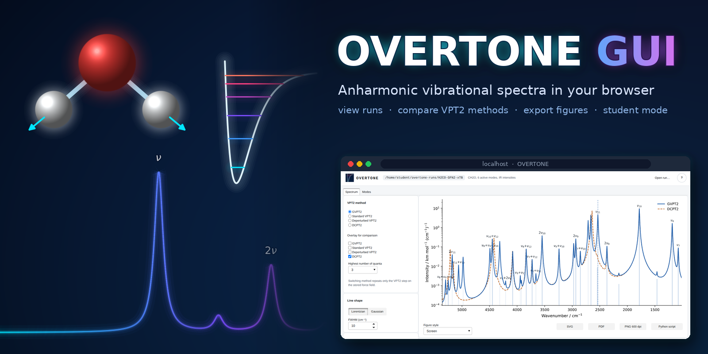
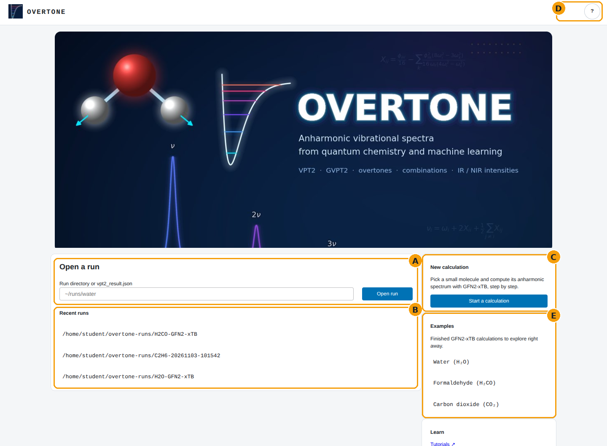
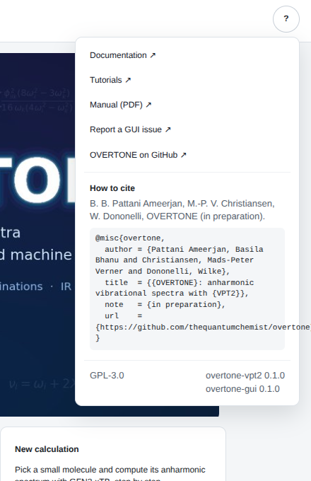
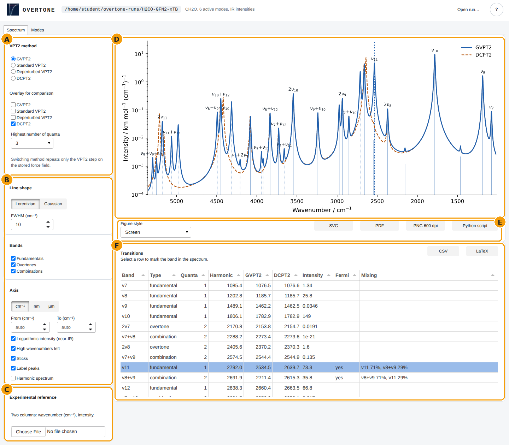
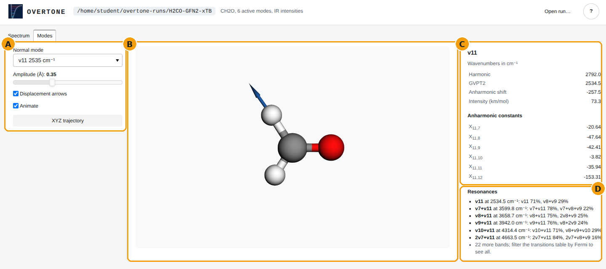
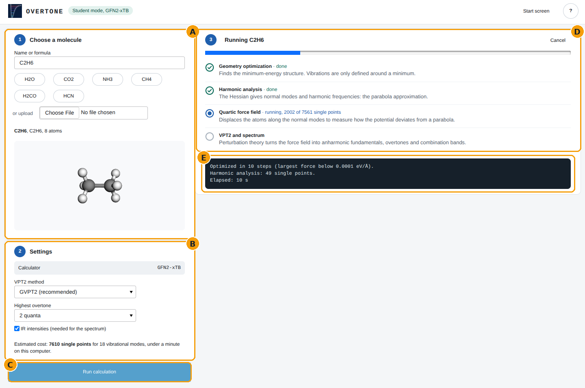
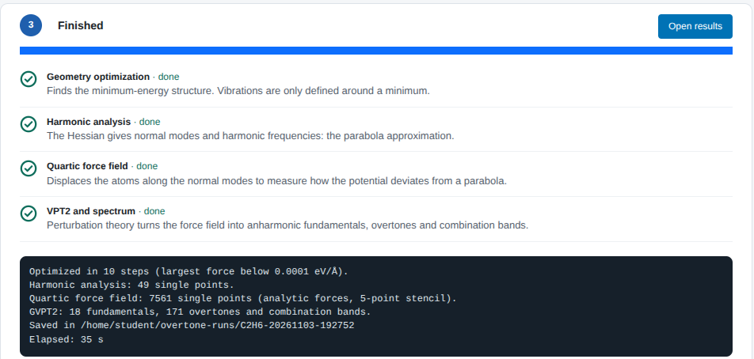

# OVERTONE GUI

[](https://github.com/thequantumchemist/overtone-gui/actions/workflows/tests.yml)

A local browser app for [OVERTONE](https://github.com/thequantumchemist/overtone),
the VPT2 package for anharmonic vibrational spectra. It opens finished
calculations, compares VPT2 variants, exports publication figures and
animates normal modes. A student mode computes small molecules with
GFN2-xTB step by step. Everything runs on your own computer and works
offline.

## Install

The GUI installs OVERTONE (`overtone-vpt2`) and everything else it needs.
Use a virtual environment:

```
python -m venv overtone-env
source overtone-env/bin/activate
pip install "overtone-gui[student] @ git+https://github.com/thequantumchemist/overtone-gui.git"
```

Without `[student]` only the viewer is installed (no GFN2-xTB). Once a release
is on PyPI, `pip install "overtone-gui[student]"` is enough.

Linux and macOS with Python 3.11 or newer; on Windows use WSL.

## Quick start

```
overtone-gui example formaldehyde  # try it right away with a bundled calculation
overtone-gui view path/to/run      # your own run, computed with save_results=True
overtone-gui student               # compute a small molecule; saved in ~/overtone-runs
overtone-gui version
```

The app opens in your browser and stops when you press Ctrl+C in the
terminal. `python -m overtone_gui ...` works the same way.

A run directory is what `calculate_anharmonics(..., save_results=True)`
writes. A single `vpt2_result.json` opens too, then with the stored method
only and without mode animation.

### Example data

Three finished GFN2-xTB calculations come with the package, so you can
explore the viewer before running anything. `overtone-gui example` lists
them; the start screen has buttons for them too.

| Example | What it shows |
|---|---|
| `water` | The smallest case: three modes, fundamentals, overtones and combination bands into the near-IR. |
| `formaldehyde` | A Fermi resonance: the CH stretch ν₁₁ mixes with ν₈+ν₉ (about 71 % / 29 %). Compare GVPT2 with DCPT2. |
| `carbon-dioxide` | A linear molecule with a degenerate bend. GFN2-xTB places 2ν₂ about 230 cm⁻¹ below ν₁, so CO₂'s well-known ν₁ / 2ν₂ Fermi resonance does not appear at this level of theory. |

Each example holds only the six JSON files the viewer needs (in
`src/overtone_gui/examples/`); `tools/make_examples.py` recomputes them.

## How it works

The screenshots show a GFN2-xTB calculation of formaldehyde (CH₂O) and, in
student mode, ethane (C₂H₆). The amber letters refer to the descriptions
below each picture.

### 1. Open a run



- **A — Open a run.** Enter a run directory or a `vpt2_result.json` and press
  *Open run* (or Enter).
- **B — Recent runs.** Everything you opened before, one click away.
- **C — New calculation.** Starts student mode; this card appears when the
  app was started with `overtone-gui student`.
- **D — Help.** Links to the OVERTONE documentation, tutorials and manual, a
  place to report GUI issues, how to cite OVERTONE (with BibTeX) and the
  installed versions.
- **E — Examples.** Open one of the bundled calculations with one click.



### 2. Explore the spectrum



- **A — VPT2 method.** Switch between GVPT2, standard VPT2, deperturbed VPT2
  and DCPT2, overlay other methods for comparison, and choose the highest
  number of quanta. Only the VPT2 step is repeated on the stored force
  field, so this takes seconds, as `recompute_vpt2` does.
- **B — Line shape, bands and axis.** Lorentzian or Gaussian broadening with
  its width; which band types to include (fundamentals, overtones,
  combinations); wavenumber, nm or µm; the range; a logarithmic intensity
  axis for the weak near-IR bands; sticks, peak labels and the harmonic
  spectrum.
- **C — Experimental reference.** A two-column file (wavenumber in cm⁻¹,
  intensity). Up to 200 rows are read as band positions and broadened like
  the calculation; longer files are drawn as a measured spectrum. The
  reference is scaled to the calculated spectrum.
- **D — Spectrum.** What you see is what you export. Dotted sticks mark bands
  in a Fermi resonance; the dashed vertical line marks the band selected in
  the table. Here GVPT2 resolves the ν₁₁ / ν₈+ν₉ Fermi dyad (71 % / 29 %
  mixing), while DCPT2 places the two bands almost on top of each other.
- **E — Export the figure.** Styles for the screen, a single journal column
  (3.35 in), a double column (7 in) and slides; save as SVG, PDF, PNG at
  600 dpi, or as a short Python script that redraws the spectrum with
  OVERTONE's own API.
- **F — Transitions.** One row per band: type, quanta, harmonic and
  anharmonic wavenumbers for every method shown, intensity, Fermi flag and
  mixing. Click a row to mark the band in the spectrum. Export as CSV or as
  a LaTeX table (booktabs, ν labels) for the SI.

### 3. Look at the normal modes



- **A — Mode and animation.** Choose the normal mode, the amplitude, arrows
  and animation; download one period as an XYZ trajectory.
- **B — 3D view.** Drag to rotate, scroll to zoom. The molecule is turned
  face on automatically; the exported XYZ keeps the original coordinates.
- **C — Wavenumbers and anharmonic constants.** Harmonic and anharmonic
  wavenumber for the method chosen in the Spectrum tab, the anharmonic
  shift, the intensity and the row X<sub>ij</sub> of anharmonic constants.
- **D — Resonances.** The Fermi-resonant bands involving this mode, with
  their mixing.

### 4. Student mode

`overtone-gui student` opens the calculation screen directly.



- **A — Choose a molecule.** 94 closed-shell molecules with 2 to 8 atoms
  from ASE's G2 set, by name or with the quick buttons, or upload your own
  `.xyz` file. Radicals and larger molecules are rejected with an
  explanation. A 3D preview shows the structure.
- **B — Settings.** The calculator is GFN2-xTB. Choose the VPT2 method, the
  highest overtone and whether to compute IR intensities. The cost estimate
  counts the single points and times one of them on this computer.
- **C — Run.**
- **D — Live progress.** The four steps of an anharmonic calculation, each
  with one sentence on what is happening, and the single points done so far.
  *Cancel* stops between two single points.
- **E — Log.** Optimization steps, single points per step, number of bands
  and where the run was saved.

In our tests water took about a second and the largest allowed molecules
(8 atoms, about 7600 single points) under a minute; slower computers need
proportionally longer.



*Open results* shows the run in the viewer (sections 2 and 3). Every
calculation is saved in its own folder in `~/overtone-runs` (change it with
`--runs-dir`), so it can be opened again later with `overtone-gui view`.

## Develop

```
git clone https://github.com/thequantumchemist/overtone-gui.git
cd overtone-gui
python -m venv .venv && source .venv/bin/activate
pip install -e ".[student,test]"
pytest
```

The GUI uses OVERTONE's result files and `recompute_vpt2`, `estimate_cost`
and `SerialEngine`. The test workflow therefore runs twice: against the
released `overtone-vpt2` from PyPI and against the `main` branch of OVERTONE,
so changes in the core that would break the GUI show up before they are
released.

## Release

1. Bump the version in `pyproject.toml` and `src/overtone_gui/__init__.py`
   in a pull request.
2. After merging, create a GitHub Release with the tag `v<version>`
   (for example `v0.1.0`).

The publish workflow runs the tests on all supported Pythons, builds the
package and uploads it to PyPI via trusted publishing (no API token).

## License

GPL-3.0-or-later, like OVERTONE. 3Dmol.js (BSD-3-Clause, see
`src/overtone_gui/static/3Dmol-LICENSE.txt`) is bundled for the offline 3D
view.
